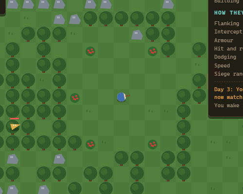
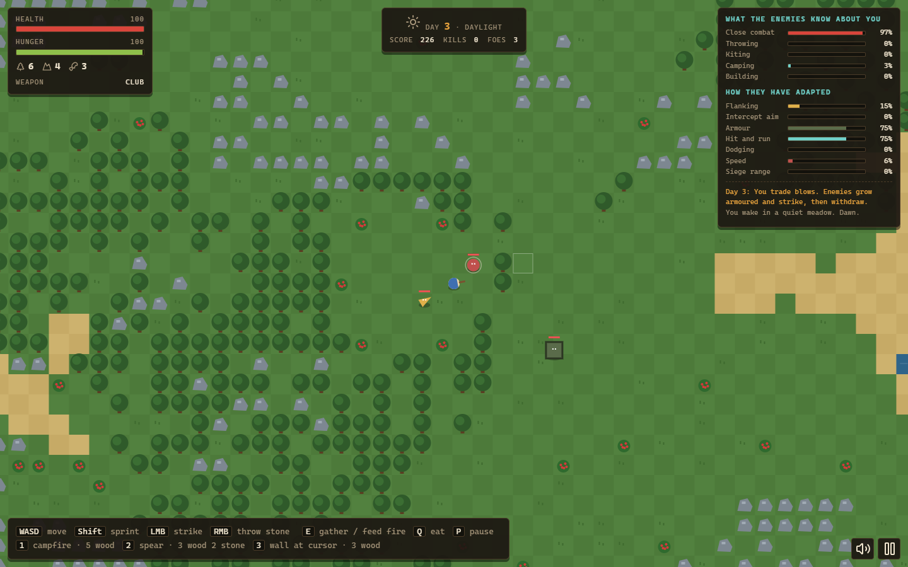
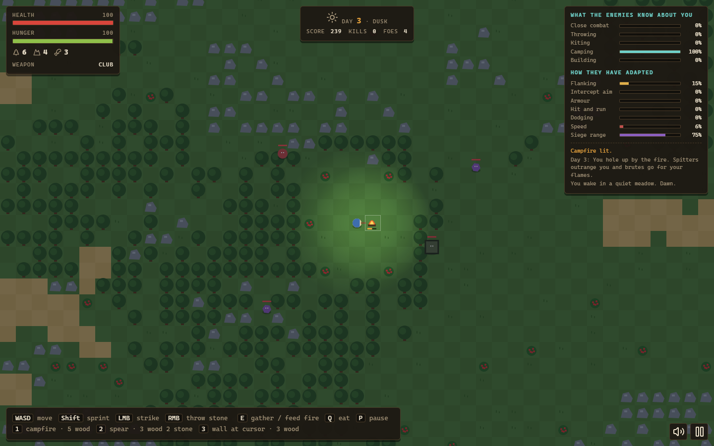
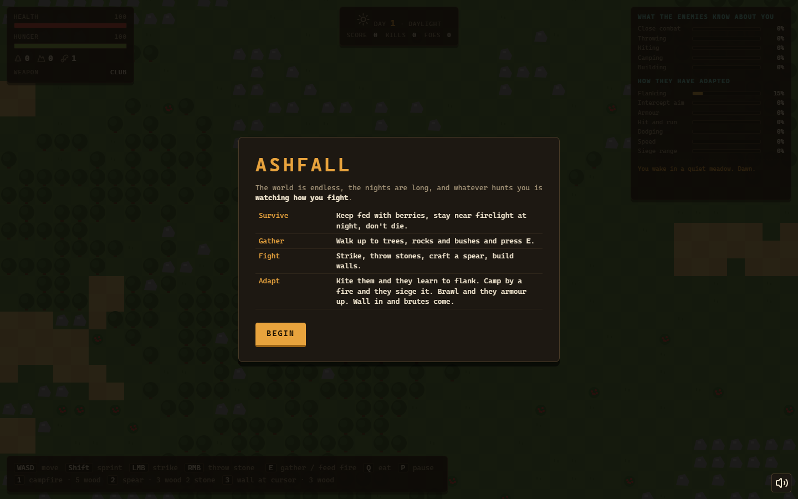
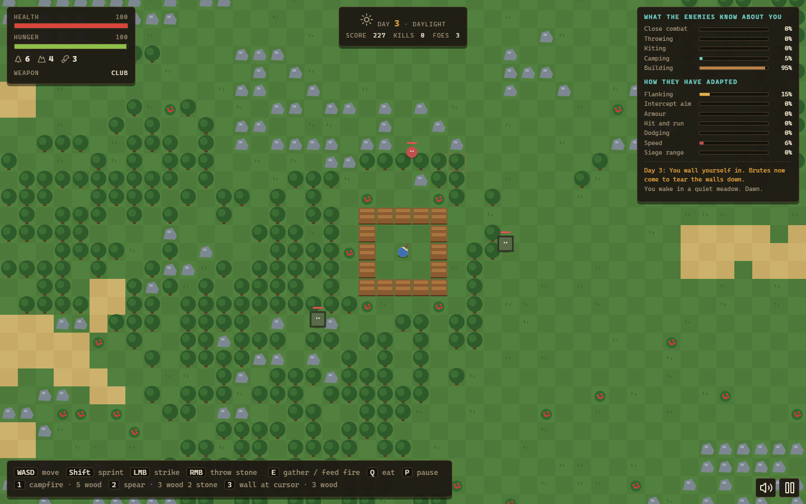
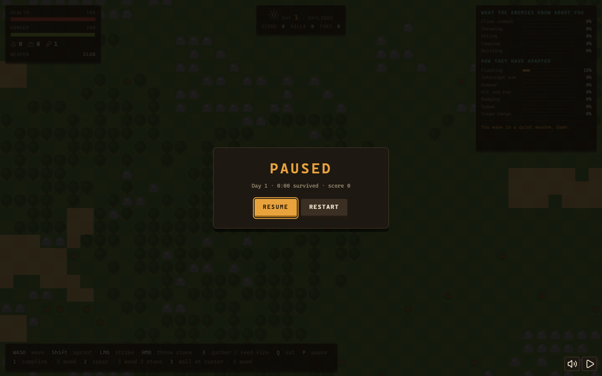
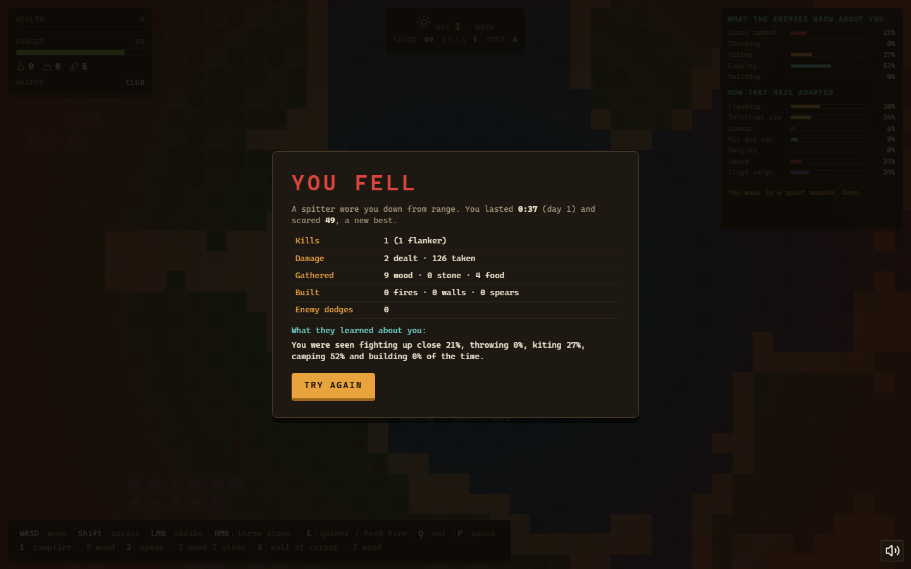
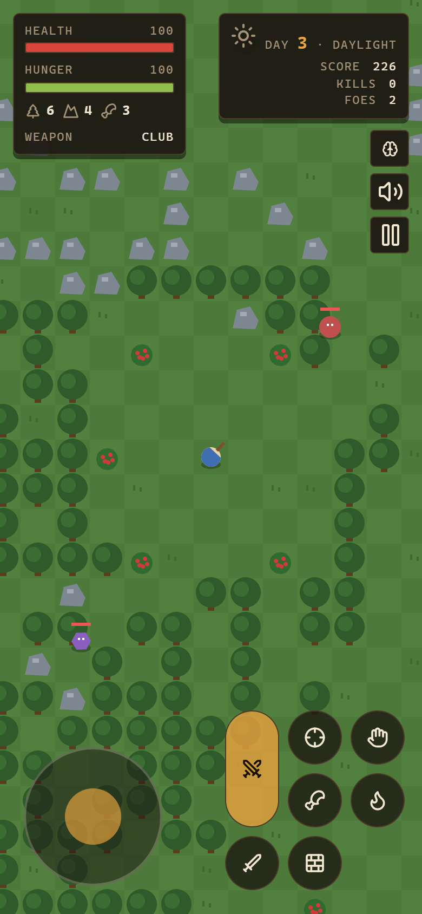

# Ashfall: Survival with Adaptive Enemies

A top-down survival game for the browser. Gather wood, stone and berries, keep a fire burning through the night, and fight off four kinds of enemies, which learn from how you play. Kite them and they start flanking and leading their attacks. Camp by the fire and spitters siege you from range while brutes raid the flames. Brawl and they armour up and fight hit-and-run. Wall yourself in and brutes come to tear the walls down.

**Play:** https://delilahg.github.io/ashfall-survival/



| Day combat with the intel panel | Dusk siege on a campfire camper |
| --- | --- |
|  |  |

## Features

- **An endless procedural world** from seeded value noise: water, sand, meadows, forests, rock fields and berry bushes. Picked bushes regrow after two minutes. Share a world with `?seed=12345`.
- **Survival pressure**:
  - hunger drains faster while sprinting, and starving costs health
  - health regenerates when fed, and much faster beside a fire
  - nights are dark, and the cold hurts unless you stand in firelight
  - fires burn fuel and must be fed with wood
- **Combat**:
  - a melee strike with a hit arc and knockback
  - a craftable spear: more reach and damage, 30 uses
  - thrown stones as projectiles
  - walls that block enemies and spit
- **Crafting**: campfire (5 wood), spear (3 wood + 2 stone), wall (3 wood, placed at the cursor with a placement preview).
- **Four enemy types with distinct behaviour**:
  - **Chaser**: direct pursuit. Weaves when it expects stones.
  - **Flanker**: predicts your position and approaches from the side before committing.
  - **Spitter**: holds a preferred range, strafes, and fires leading shots, but only with line of sight.
  - **Brute**: slow and heavy, unafraid of fire. Raids campfires near you and smashes walls.
- **Navigation**: enemies with no line of sight follow a breadth-first flow field around trees, water and your walls. If you are fully walled in, the field reports you as unreachable, and brutes go through the walls instead.
- **Reactive dodging**: enemies that have learned you throw stones detect incoming stones on a collision course and sidestep them.
- **Adaptation you can watch**: the HUD shows the enemies' current read of your play style and how each counter-trait has shifted. A log announces each day's new counter-strategy.
- **Progression**: a day/night cycle with more and faster spawns over the days, larger night waves, and enemy health that grows each day.
- **Score and stats**: score is survival seconds plus kill points (chaser 10, flanker 12, spitter 15, brute 30). Your best run is kept in `localStorage`. The game-over screen breaks down kills by type, damage, resources gathered, things built, enemy dodges, and what they learned.
- **Game states**: start screen, pause menu (P / Esc / button) with resume and restart, game over with try again. The game also pauses automatically when the tab loses focus.
- **Sound**: procedural effects synthesised with the Web Audio API, so there are no audio files. Toggle with M; the setting is remembered.
- **Touch controls** on phones and tablets: a virtual stick, auto-aim at the nearest enemy, and buttons for strike, throw, gather, eat and the three crafts. The intel panel folds into a button on small screens.
- **Accessibility**: `prefers-reduced-motion` turns off screen shake, flicker and water shimmer. Icons are SVG (Lucide), not emoji.

## How the adaptation works

This is **rule-based online adaptation**, not machine learning. Nothing is trained offline and there are no neural networks.

1. **Observe.** While you play, the game scores five behaviours:
   - *close combat*: swinging with an enemy within 150 px
   - *throwing*: each stone thrown
   - *kiting*: sprinting away from a nearby enemy (moving at more than 70 px/s with your velocity pointing away from it, 70–240 px)
   - *camping*: standing still by a fire or with enemies close
   - *building*: placing walls
2. **Forget.** The profile decays exponentially with a 45 s half-life, so the enemies track your *current* habits and you can shake off a read by changing style.
3. **Counter.** Each behaviour's share of the profile sets a target for the enemy "genes":

   | Your habit | Their counter |
   | --- | --- |
   | Kiting | Flank angle, intercept lead, move speed, more flankers |
   | Camping | Longer spitter range, more spitters, brutes that raid fires |
   | Close combat | Armour (more HP), hit-and-run retreat after striking, more brutes |
   | Throwing | Dodge chance, which drives the weaving and the reactive sidestep |
   | Building | Many more brutes, which smash walls |

   Every 15 s the genes move 25% of the way to their targets. At the start of each day they move 50%, and the change is announced. New enemies are spawned with the current genes plus individual variation.

The tests check that this is more than flavour text:
- A profile dominated by one behaviour produces that behaviour's counters and no others.
- Enemies route around walls, and brutes break walls when you're enclosed.
- Learned dodging measurably reduces stone hits. In a test harness with a stone thrown at a chaser 100 px away (200 trials per setting):

| Dodge gene | Stones that hit |
| --- | --- |
| 0 (untrained) | 100% |
| 0.4 | 59% |
| 0.85 (maximum) | 16% |

## Technology

- Vanilla JavaScript (ES modules) and Canvas 2D, with no game engine. The build is about 43 KB of JS (17 KB gzipped).
- [Vite](https://vite.dev) for the dev server and build, and [Lucide](https://lucide.dev) for icons.
- The Web Audio API for sound.
- Node's built-in test runner, [Playwright](https://playwright.dev) for browser tests, and ESLint.

## Getting started

Requires Node.js 20 or newer.

```bash
npm install
npm run dev        # http://localhost:5173
npm run build      # production build in dist/
npm run preview    # serve the build at http://localhost:4173
npm run deploy     # publish dist/ to the gh-pages branch
```

No environment variables, accounts or backend are needed.

### Controls

| Action | Keyboard / mouse | Touch |
| --- | --- | --- |
| Move / sprint | WASD or arrows / hold Shift | Stick (push to the edge to sprint) |
| Strike | Left mouse (hold) | Large button |
| Throw stone | Right mouse | Crosshair button |
| Gather, or feed a nearby fire | E | Hand button |
| Eat | Q | Drumstick button |
| Campfire / spear / wall | 1 / 2 / 3 (wall at cursor) | Flame / sword / wall buttons |
| Pause | P or Esc | Pause button |
| Sound | M | Speaker button |

## Testing

```bash
npm run lint       # ESLint
npm test           # 35 unit tests (Node test runner)
npm run test:e2e   # 9 Playwright browser tests (builds and serves the app)
npm run check      # everything, including the production build
```

On Windows the browser tests use the preinstalled Microsoft Edge. Elsewhere, run `npx playwright install chromium` once, or set `PW_CHANNEL=chrome`.

**What the tests cover**

- *World*: deterministic terrain per seed, a walkable spawn area for 40 seeds, collision with sliding and without tunnelling, line of sight, bush regrowth, and flow-field routing around a wall (gradient descent never enters a wall tile). An enclosed player is reported as unreachable.
- *Adaptation*: profile half-life, share normalisation, no adaptation before enough has been observed, the specific counters for each of the five habits, the announcement messages, and spawn-type sampling that matches the weights.
- *Game rules*:
  - determinism by seed
  - harvest yields, crafting costs and failure cases (stacking, distance, building on the player)
  - fire fuel and feeding, healing near fire
  - hunger, eating and starvation death, night exposure, the time-of-day labels
  - enemy melee and invulnerability frames
  - strike kills, scoring and spear reach, stone hits
  - learned dodging lowering the hit rate (statistical test)
  - pathing around walls, brutes breaking walls
  - day-change announcements and the difficulty curve
  - kiting detection
  - a 4-minute headless soak with no NaNs and every enemy type spawned
  - a performance budget: 40 enemies under 2 ms per update
  - actions ignored after death
- *Browser*:
  - the start screen and live HUD, with no emoji
  - keyboard movement and gathering, mouse combat that kills and scores
  - pause, resume and restart; crafting via the number keys; game over with a stored best score and try again
  - the persisted sound toggle and auto-pause on blur
  - on a touch phone: stick movement, touch crafting, the intel panel, and no horizontal scroll
  - no console errors throughout

Latest local run: lint clean, **35/35** unit tests and **9/9** browser tests passing.

## Architecture

```
src/
  game/                 game logic, no DOM (runs in Node for tests)
    world.js            seeded noise terrain, collision, line of sight, BFS flow field
    ai.js               enemy types, steering and dodging, the Adaptation model
    game.js             Game state: player, needs, combat, crafting, spawning, events
  render.js             Canvas renderer with a lighting layer for night
  audio.js              Web Audio sound synthesis
  main.js               input (keyboard, mouse, touch), game states, HUD, main loop
tests/unit/             Node test runner
tests/e2e/              Playwright
scripts/                screenshot / GIF capture and gh-pages deploy
```

### Engineering notes

- **Logic is separate from presentation.** `Game.update(dt, input)` takes an abstract input (a move vector, sprint, buttons and an aim point), so keyboard, mouse, touch and test bots all drive the same code. The game reports what happened through an event queue (`hit`, `kill`, `newDay` and so on), which the sound and HUD read without the game knowing they exist.
- **Seeded randomness.** All gameplay randomness, including terrain, spawns and enemy variation, comes from a seeded PRNG, so a run can be reproduced exactly. Cosmetic particles deliberately use `Math.random` so they never shift the gameplay random sequence.
- **Flow field over per-enemy A\*.** A single BFS over a 45×45-tile window around the player is shared by every enemy. It is recomputed only when the player changes tile, a wall or tree changes, or every 0.5 s. That keeps pathfinding cost independent of enemy count. Enemies use it only when line of sight is blocked, and otherwise keep their type-specific steering.
- **Collision** is circle against tile, with axis-separated movement so entities slide along obstacles. Large moves are sub-stepped so nothing tunnels through walls.
- **Performance.** Only tiles on screen are drawn, and generated tiles are cached. One update with 40 active enemies takes well under 2 ms (checked by a test).

## Limitations and known issues

- Balance has been tuned by playing and with scripted bots, not with a wide group of players. Some styles may be stronger than intended.
- Enemies only consider the player and fires as targets. There are no group tactics beyond the shared adaptation.
- The flow field covers 22 tiles around the player. Enemies further away steer directly until they come into range.
- The world is endless, but only player changes are stored, and only in memory. There is no save game.
- On touch devices aiming is automatic (nearest enemy within 320 px), so precise stone throws are easier with a mouse.
- `npm audit` reports a moderate advisory in `minimatch`, pulled in by ESLint. It only affects the local lint tooling, not the shipped game.

## Possible improvements

- More counter-strategies, such as pack encirclement against a melee-heavy player, and a way to show which counter each enemy carries.
- Saving and loading runs, plus a daily seed challenge.
- Gamepad support.

## Screenshots

| | |
| --- | --- |
|  |  |
|  |  |



All images are captured from the production build by `npm run screenshots`. Most scenes are set up through the in-page test hook (seed, resources, time of day and a pre-taught play style); the game-over screen comes from a scripted bot playing until it dies.

## License

[MIT](LICENSE)
